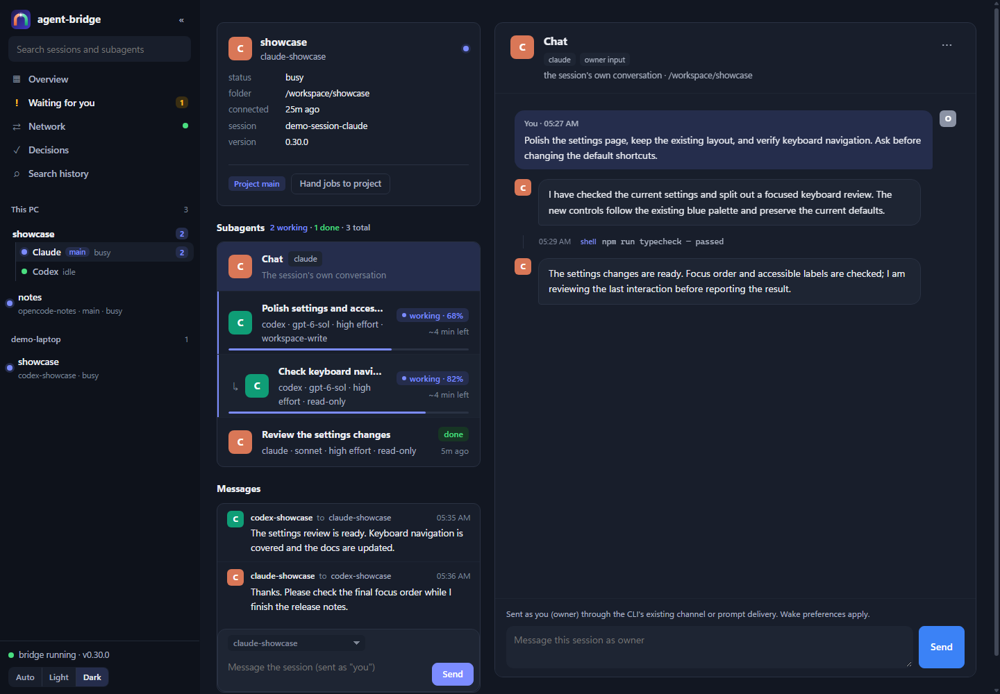
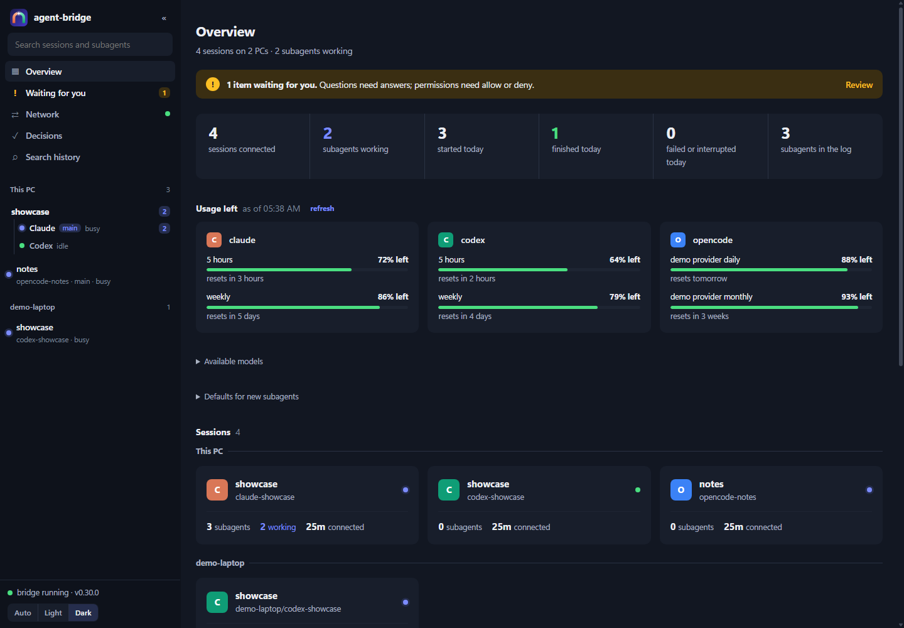
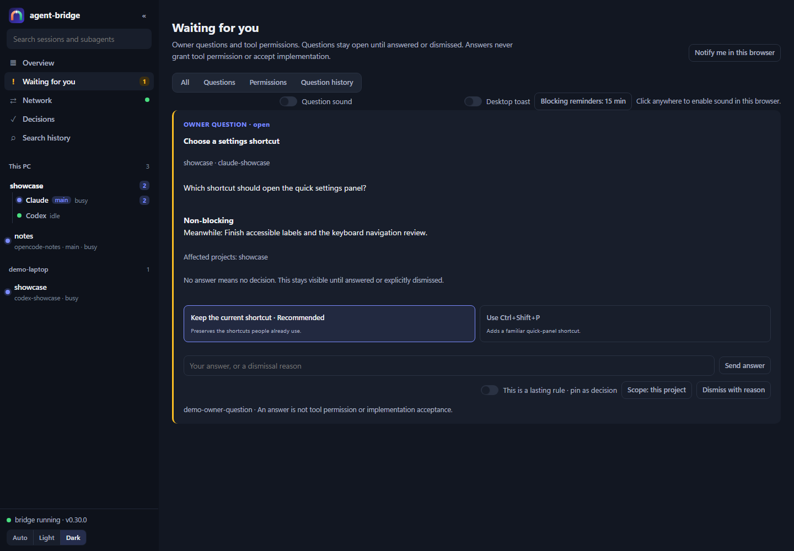
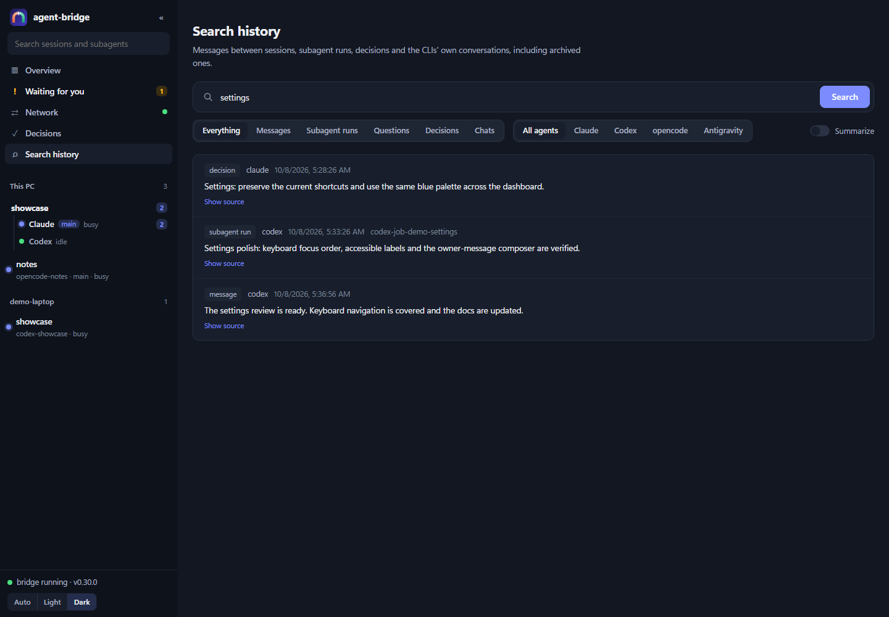
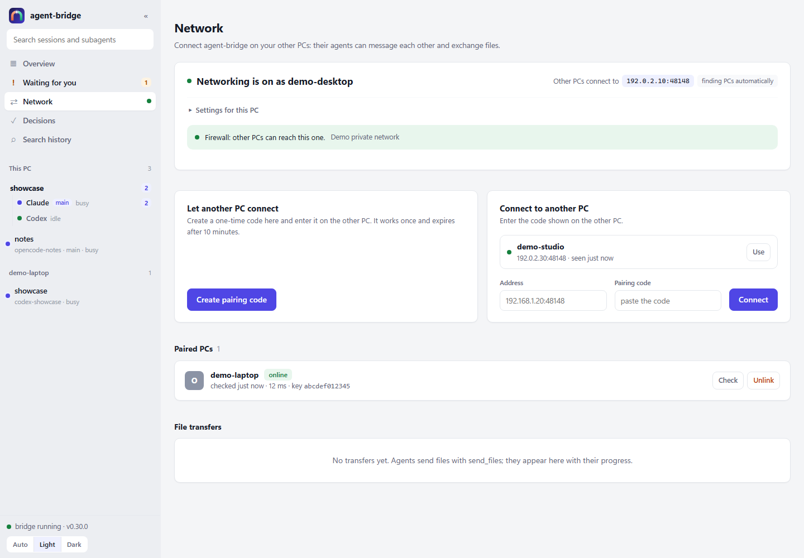

<p align="center">
  
</p>

<h1 align="center">agent-bridge</h1>

<p align="center">
  <b>Your coding agents, working as one team.</b><br>
  Claude Code, OpenAI Codex, opencode, Google Antigravity CLI and Muse message each other,<br>
  hand each other work as subagents and share their history, on one PC or several.
</p>

<p align="center">
  <a href="https://agent-bridge.renner.dev/"><b>Website</b></a> ·
  <a href="https://agent-bridge.renner.dev/overview/">Documentation</a> ·
  <a href="#install">Install</a> ·
  <a href="CHANGELOG.md">Changelog</a> ·
  <a href="https://github.com/rennerdo30/agent-bridge/issues">Issues</a> ·
  <a href="LICENSE">MIT license</a>
</p>

<p align="center">
  
</p>

## Why agent-bridge

Every coding CLI is good at something, and each one runs alone in its own terminal. agent-bridge gives them a shared **address book, mailroom and job board**: a Claude session can ask Codex for a review, Codex can start two opencode subagents in worktrees, and any of them can ask **you** a question that waits in one place until you answer.

It runs entirely on your machines. There is no account and no server of ours: one small broker per PC, SQLite under `~/.agent-bridge`, and a dashboard on `127.0.0.1`.

## Features

| | |
|---|---|
| **Messaging between agents** | Sessions send each other questions, reviews and results. Messages to an offline or idle agent wait and wake it when possible. |
| **Any CLI delegates to any CLI** | Claude, Codex, opencode, Antigravity and Muse each expose `spawn` for every coding agent, including their own kind (`wait: true` returns the answer). Depth, slot, ownership and hop guards apply. Talk to a running subagent, continue a finished one with its full context, cancel it, or hand all of them to another session. |
| **Worktrees and access levels** | Subagents are read-only by default. Raise access per job (`read`, `ask`, `edit`) and give editing jobs their own git worktree. |
| **A main and a secondary** | A Claude and a Codex session in the same folder share their project's jobs. The main is the first contact; if it closes or runs out of usage, the secondary takes over and nothing is lost. |
| **Checklists for subagents** | Give a job a to-do list at spawn; the project's definition of done is added automatically. The job ticks items and proposes new ones for your approval, and the result says when required items are still open. |
| **Questions to you** | Agents ask you decisions in one place. You hear a chime in the dashboard, or get a Windows notification that opens the question. Your answer goes straight back to the agent that asked, and can be pinned as a lasting decision. |
| **One dashboard** | Sessions, subagent trees, chats, progress with ETA, approvals, pinned decisions, usage left per CLI, full history search and paired PCs, at `http://127.0.0.1:4777`. |
| **Paired PCs** | Two PCs pair once over TLS 1.3 with a one-time code. Their agents then message each other, transfer files and start jobs on the other PC. |
| **Nothing gets lost** | Every message, job, chat and decision is stored and searchable. History is archived, never deleted, and upgrades migrate your data with a backup first. |

<table>
  <tr>
    <td></td>
    <td></td>
  </tr>
  <tr>
    <td align="center"><b>Overview</b>: every session on every paired PC, what is running and how much usage is left.</td>
    <td align="center"><b>Waiting for you</b>: questions and permission requests from your agents, in one place.</td>
  </tr>
  <tr>
    <td></td>
    <td></td>
  </tr>
  <tr>
    <td align="center"><b>Search history</b>: messages, subagent runs, decisions and the CLIs' own conversations.</td>
    <td align="center"><b>Paired PCs</b>: pair once with a one-time code, then share mail, files and jobs.</td>
  </tr>
</table>

## Supported CLIs

| | Claude Code | Codex | opencode | Antigravity | Muse |
| --- | :---: | :---: | :---: | :---: | :---: |
| Messaging, peers, owner questions, decisions | ✅ | ✅ | ✅ | ✅ | ✅ |
| Delegate to and from every CLI, follow-ups, worktrees | ✅ | ✅ | ✅ | ✅ | ✅ |
| Wake an idle session with new mail | ⚠️ | ⚠️ | ✅ | ⚠️ | ⚠️ |
| Transcripts in search and the dashboard | ✅ | ✅ | ✅ | ✅ | ✅ |
| Paired-PC messaging and jobs | ✅ | ✅ | ✅ | ✅ | ✅ |
| Set up by `install` / `update` | ✅ | ✅ | ✅ | ✅ | ✅ |

⚠️ means partial support that depends on the CLI's version and settings. The **[full support matrix](https://agent-bridge.renner.dev/reference/support-matrix/)** lists every feature with its exact limits.

Experimental: [T3 Code session messaging and MCP profiles](docs/t3-code.md). Injected scoped ACP transport is detected automatically; validated T3 sessions default to reduced tools with remote Bridge delegation kept. Set `AGENT_BRIDGE_MCP_PROFILE=full` for the full surface. Native Codex without injected transport is not supported.

## Install

Requires **Node.js 24+** (the current LTS); older versions refuse to start. Install for every supported CLI found on your machine:

```bash
npx -y github:rennerdo30/agent-bridge install
```

It shows its plan per tool and asks first; add `--yes` to skip the questions, or name tools: `install claude codex opencode antigravity muse`. In Codex, open `/hooks` once and trust the agent-bridge hooks. Per-CLI details: [Installation](https://agent-bridge.renner.dev/getting-started/install/).

## Update

```bash
npx -y github:rennerdo30/agent-bridge update
npx -y github:rennerdo30/agent-bridge status   # which sessions still run an older version
```

You can update while sessions run. New sessions start on the new version, and running ones switch at their next plugin reload. Mixed versions keep working together. See [Updating](https://agent-bridge.renner.dev/getting-started/update/).

## First steps

Just ask your agent in plain language:

> Ask Codex to review the diff in `src/auth` and tell me what it finds.

> Start two Codex subagents in worktrees: one writes the tests, one fixes the bug.

> Hand all your subagents to codex-myproject, I'm closing this session.

> Open the agent-bridge dashboard.

All tools, parameters and behavior are in the [MCP tools reference](https://agent-bridge.renner.dev/reference/tools/).

## How it works

```
 Claude Code session     Codex session          opencode · Antigravity · Muse
┌──────────────────┐    ┌──────────────────┐    ┌──────────────────┐
│ agent-bridge MCP │    │ agent-bridge MCP │    │ agent-bridge MCP │
│ hooks · channels │    │ hooks · app-srv  │    │ plugin · hooks   │
└────────┬─────────┘    └────────┬─────────┘    └────────┬─────────┘
         └───── local pipe (named pipe or Unix socket) ──┘
                                 │
                ┌────────────────┴───────────────┐
                │ broker daemon                  ├── dashboard 127.0.0.1:4777
                │ messages · jobs · decisions    │
                │ SQLite in ~/.agent-bridge      ├── paired PCs over TLS 1.3
                └────────────────────────────────┘
```

- **One broker per PC.** The first session that finds no broker starts a background daemon. It outlives that session, hands over cleanly to a newer release after an update, and exits after 10 minutes without clients.
- **Detached jobs.** Subagents run in their own job runners, so they survive plugin reloads.
- **Approvals go up, not around.** A job's permission requests go to the session that started it, or to you. An identical repeat request in the same job turn can reuse a grant under strict conditions; denials are never reused.

Details: [How it works](https://agent-bridge.renner.dev/concepts/how-it-works/) and [Configuration](https://agent-bridge.renner.dev/configuration/).

## ⚠️ WHAT AGENT-BRIDGE MAY DELETE ON YOUR DISK

> [!WARNING]
> **Read this before you turn on any cleanup.** By default agent-bridge removes nothing of yours.
>
> - **Job worktrees only, and only ones agent-bridge created itself.** When a subagent gets its own git worktree, agent-bridge writes an ownership record for it at creation time. A worktree without that record, or whose folder was replaced, is **never** touched, whatever its branch or folder name. Your own worktrees and checkouts are never removed.
> - **Automatic removal when a job closes is OFF by default** (`jobCloseCleanup: false`). If you turn it on, a finished job's worktree is removed only when **all** of these hold: no uncommitted or untracked files, no unknown ignored files, no links into other folders, and every commit has first been pushed and verified on your remote (as `wip/<job>`). If any check fails, the worktree is kept and the reason is recorded. Local branches are always kept.
> - **`agent-bridge cleanup`** is manual. Without `--yes` it only lists what it would remove. With `--yes` it removes only worktrees that are inside agent-bridge's own worktree folder, belong to a recorded agent-bridge job, are on an `agent-bridge/*` branch fully merged into its base, and have nothing uncommitted. Everything else is kept.
> - **Your history and messages are never deleted.** Old data is archived. `agent-bridge storage finalize` removes old backup copies only after a migration has been verified with counts and hashes, and only when you confirm with `--yes`.
>
> If you are unsure, leave cleanup off. Nothing breaks; worktrees simply stay until you remove them.

## Security

- Only your own agent-bridge processes can connect: every connection presents a secret from `~/.agent-bridge/token`.
- The dashboard listens on `127.0.0.1` only and needs its access key.
- Subagents are **read-only by default**. You raise access per job, and edits can be isolated in worktrees.
- Messages from other agents are marked as such, and agents are told not to act destructively only because a peer asked.
- Pairing uses TLS 1.3 with a one-time code; discovery never connects on its own.

Details: [Security](https://agent-bridge.renner.dev/reference/security/).

## Development

```bash
npm install
npm run check   # typecheck, tests and build
```

`npm run build` bundles `src/` into `plugins/*/dist`, which is committed in release PRs so the plugins install straight from Git. The website and documentation live in `docs/` (Astro Starlight; the homepage is `docs/src/pages/index.astro`). Contributions: [CONTRIBUTING.md](CONTRIBUTING.md).

## License

[MIT](LICENSE). A project by [rennerdo30](https://github.com/rennerdo30). The plugin bundles include third-party libraries under their own licenses; see [THIRD_PARTY_NOTICES.md](THIRD_PARTY_NOTICES.md).

agent-bridge is an independent open-source project. It is not affiliated with, endorsed by or sponsored by Anthropic, OpenAI, Google or the makers of the other tools it works with. Claude Code, OpenAI Codex, Google Antigravity, opencode, Muse, T3 Code and other product names are trademarks or names of their respective owners and are used only to describe compatibility.
