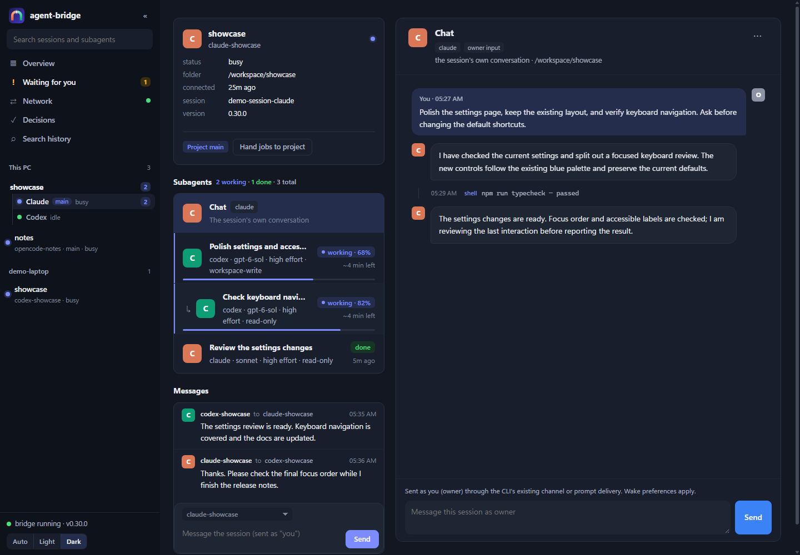

# agent-bridge

**Let Claude Code, OpenAI Codex, opencode, Google Antigravity CLI and Muse work together.**

agent-bridge connects the coding agents on your machine, and on PCs you pair, into one team. They message each other, hand each other work as subagents, and share history. You follow and steer everything from one local dashboard.

**[Documentation](https://rennerdo30.github.io/agent-bridge/)** · [Install](#install) · [Update](#update) · [Changelog](CHANGELOG.md)

Experimental opt-in host integration: [T3 Code session messaging and T3-owned tasks](docs/t3-code.md) (requires explicitly injected scoped ACP transport).



## What it does

- **Messaging between agents.** Sessions send each other questions, reviews and results. Messages to an offline or idle agent wait and wake it when possible.
- **Any CLI can delegate to any CLI, including itself.** Claude, Codex, opencode, Antigravity and Muse each expose every coding agent's `ask_*` and `spawn_*` tools. Depth, slot, ownership and hop guards still apply. You can talk to a running subagent, continue a finished one with its full context, cancel it, or hand all of them to another session. Edits can run in their own git worktree.
- **Projects with a main and a secondary.** A Claude and a Codex session in the same folder share their project's jobs. The main session is the first contact. If it closes or runs out of usage, the secondary takes over and nothing is lost.
- **Questions to you.** Agents ask you decisions in one place. You hear a chime in the dashboard, or get a Windows notification that opens the question. Your answer goes straight back to the agent that asked.
- **A dashboard for everything.** Sessions, subagent trees, chats, progress with ETA, approvals, pinned decisions, full history search and paired PCs, at `http://127.0.0.1:4777`.
- **Paired PCs.** Two PCs pair once over TLS. Their agents then message each other, transfer files and start jobs on the other PC.
- **Nothing gets lost.** Every message, job, chat and decision is stored and searchable. History is archived, never deleted, and upgrades migrate your data with a backup first.

## CLI feature support matrix

This table describes **agent-bridge 0.30.17**, plus the unreleased Muse column. ✅ supported · ⚠️ partial (see footnotes) · ❌ not supported. Delegation rows describe the CLI running the job; “delegate from” describes the supervising session. Muse behavior is covered by protocol fixtures and subprocess tests; live Muse binary/provider acceptance remains pending.

| Feature | Claude Code | Codex | opencode | Antigravity | Muse |
| --- | --- | --- | --- | --- | --- |
| Session connection, peers, send/receive | ✅ | ✅ | ✅ | ✅ | ✅ |
| Messages while busy (hooks / next tool or model step) | ✅ | ✅ | ✅ | ✅ | ✅ |
| Idle message delivery / auto-wake | ⚠️[^claude-wake] | ⚠️[^codex-wake] | ✅ | ⚠️[^antigravity-wake] | ⚠️[^muse-wake] |
| Delegate **to** (`ask_*` / `spawn_*` target) | ✅ | ✅ | ✅ | ✅ | ✅ |
| Delegate **from** (all five targets, including itself) | ✅ | ✅ | ✅ | ✅ | ✅ |
| Follow-ups / resume (`message_subagent`) | ✅ | ✅ | ✅ | ✅ | ✅[^muse-msp] |
| Jobs in isolated git worktrees | ✅ | ✅ | ✅ | ✅ | ✅ |
| Live job steps, progress and ETA | ✅ | ✅ | ✅ | ✅ | ✅[^muse-msp] |
| Job model and effort selection | ✅ | ✅ | ⚠️[^opencode-models] | ✅ | ✅ |
| `list_models` for this CLI | ⚠️[^claude-models] | ✅ | ⚠️[^opencode-models] | ✅ | ✅[^muse-models] |
| Job access: `read` / `ask` / `edit` | ⚠️[^claude-permissions] | ⚠️[^codex-permissions] | ✅ | ✅ | ✅[^muse-permissions] |
| Job approval relay to supervisor | ⚠️[^claude-permissions] | ⚠️[^codex-permissions] | ⚠️[^opencode-permissions] | ✅[^antigravity-permissions] | ⚠️[^muse-permissions] |
| Native job approval / sandbox options | ✅ `permission_mode` | ⚠️ `sandbox`, `approvals_reviewer`[^codex-permissions] | ✅ `auto_approve` | ✅ `terminal_sandbox`, `bypass_permissions` | ✅ `permission_profile`[^muse-permissions] |
| Nested bridge subagents (depth limit) | ✅ | ✅ | ⚠️[^nested-opencode] | ✅ | ✅ |
| Scoped native child bridge addresses | ⚠️[^native-addresses] | ❌ | ❌ | ❌ | ❌ |
| Native children excluded from top-level registration | ✅ | ✅ | ✅ | ⚠️[^native-isolation] | ✅[^muse-native] |
| `usage_limits` for this CLI | ✅ | ✅ | ⚠️[^usage] | ✅[^antigravity-usage] | ⚠️[^muse-usage] |
| Native transcript ingestion and `search_history` | ✅ | ✅ | ✅ | ✅ | ✅ |
| Dashboard native chat and child transcripts | ✅ | ✅ | ✅ | ✅ | ✅ |
| Owner questions (`ask_owner`) | ✅ | ✅ | ✅ | ✅ | ✅ |
| Pinned decisions (`decisions`) | ✅ | ✅ | ✅ | ✅ | ✅ |
| Project main / secondary roles | ✅ | ✅ | ✅ | ✅ | ✅ |
| Paired-PC messaging | ✅ | ✅ | ✅ | ✅ | ✅ |
| Jobs on a paired PC | ✅ | ✅ | ✅ | ✅ | ✅ |
| Mobile app session / job visibility | ⚠️[^mobile] | ⚠️[^mobile] | ⚠️[^mobile] | ⚠️[^mobile] | ⚠️[^mobile] |
| `install` / `update` setup | ✅ Marketplace plugin[^install] | ✅ Marketplace plugin[^install] | ✅ Native plugin[^install] | ✅ Native plugin[^install] | ✅ Native plugin[^muse-install] |

Nested bridge delegation defaults to depth **2**, configurable up to **3**; depth, slot, ownership and hop guards apply to every CLI. Owner questions, decisions and project roles belong to top-level project sessions; delegated jobs use their supervisor. Jobs without `allow_tools` may use Pair Desk worker tools (reads, comments, progress, plans, steps, edit issues; creating issues and status, build or handoff writes are not included) without asking, in every access mode including read and ask; change or clear this with `jobs.defaultAllowTools` in the home config, or per job with `allow_tools` (a list replaces it, `[]` turns it off). Transcript views and search require the CLI's local transcript files or database. Paired-PC jobs require an enabled remote-job policy, an allowed agent and an absolute working directory within the receiving PC's allowed roots.

[^claude-wake]: Idle delivery uses a channel when enabled, the wake module on Claude Code 2.1.287+, or the host's `asyncRewake` Stop hooks. It depends on an available wake transport and the session's wake settings; otherwise mail stays queued for a later prompt or inbox.
[^codex-wake]: Requires a known main-thread ID, native `codex queue` support and a TUI consuming that queue. Queue acceptance does not confirm a started turn or read mail. Trust the bridge hooks in `/hooks` for automatic injection.
[^antigravity-wake]: Active `PreInvocation` / Stop hooks deliver mail (retaining unread mail if a Stop continuation hits the native cap), but an already idle TUI cannot be woken. Queued mail arrives on the next turn or through inbox.
[^claude-models]: Returns native help's model aliases and effort levels, with alias fallbacks; Claude Code has no full model-catalog query here.
[^opencode-models]: The catalog is a non-exhaustive provider/model list and can be empty; explicit IDs still resolve at startup. Effort is a provider-specific variant. OpenCode 2 requires an explicit model when selecting effort.
[^claude-permissions]: `ask` stays read-only, like `read`: allowed native edits cannot reliably be intercepted. In editable modes, actual native permission prompts can be relayed through a PermissionRequest hook (Claude Code 2.1.268+, bundled hook and a launch without a shell); native allow/deny rules run first.
[^codex-permissions]: Access maps to Codex's sandbox. In app-server jobs, `approvals_reviewer` defaults to `auto_review`; choose `user` for forwarded native requests. Automatic review refusals can be escalated for a supervised retry without overriding sandbox policy. Full-access jobs and the `codex exec` fallback fix the reviewer to `user`. The exec fallback needs a trusted PermissionRequest hook for `ask`; without it, `ask` stays read-only.
[^opencode-permissions]: `ask`, and eligible `edit` runs, relay native permission events through a private served session. Plain headless runs reject requests or auto-approve with `auto_approve=true`; those requests are not relayed.
[^antigravity-permissions]: `ask` relays every non-reading tool through the installed PreToolUse gate. `edit` delegates workspace reads/writes (and pathless reading tools) to native policy—which still enforces native Ask/deny rules and soft-denies headless prompts—while relaying outside-workspace file actions, commands and external tools to the supervisor (`auto_approve`, preserving explicit native deny rules). `bypass_permissions` explicitly overrides the read/ask/edit access policy; `terminal_sandbox` is separate.
[^nested-opencode]: Read-only opencode jobs' tool allowlist enables delegation to the other four CLIs, including Muse, but omits opencode self-delegation, `list_models` and `decide`. Top-level opencode sessions expose all five targets.
[^native-addresses]: Claude only: a live native child gets `<parent>/sub:<agent_id>` on its registered parent's connection. It may use only `peers`, `inbox` and `send`, with explicit child identity, ownership and hop limits; recipients are its parent, the parent's owned jobs and exact local recipient grants. No independent registration, delegation, broadcast or remote address; remaining mail returns to the parent when the child ends.
[^native-isolation]: Antigravity ignores hooks for a child conversation on the parent's shared server. It has no equivalent MCP caller-lineage admission check, so separate child-server registration is not established by this implementation.
[^usage]: opencode reports today's spend/tokens and free-model information, not remaining provider quotas.
[^antigravity-usage]: Reads structured model quota buckets and reset times from `agy -p /usage --output-format json` (requires `agy` 1.1.11+; older versions report unknown without starting a model turn).
[^remote-antigravity]: Paired jobs accept `terminal_sandbox` and `bypass_permissions`, preserve explicit false settings on continuation, and reject these options for other agents before launch.
[^mobile]: With the mobile gateway enabled and a phone paired, each enrolled PC exposes local registered sessions and retained jobs, with chats/steps where available. Paired-PC peer projections are excluded and native child hierarchy is not projected.
[^install]: `npx -y github:rennerdo30/agent-bridge install` sets up detected CLIs; `update` publishes their next runtime while retaining old versions. Claude gets MCP/channel support, hooks, the wake module, skills, commands and agent definitions. Codex gets MCP, skills and hooks (trust them in `/hooks`). opencode gets the native plugin with `bridge_*` tools, its runtime, skill and agent definitions for both plugin API generations. Antigravity gets the native plugin, MCP configuration, skill, delivery/permission hooks and a bridge MCP grant. Running integrations adopt updates on reload or restart; an existing broker keeps its version until its host closes or reloads.
[^muse-wake]: Native command hooks deliver active-turn mail and can continue a stopping turn. Native idle-TUI wake is not confirmed; queued mail waits for another turn or inbox.
[^muse-msp]: Stable MSP v1 over `muse serve` is the default job transport, including live steering and native item progress. `AGENT_BRIDGE_MUSE_EXEC=1` explicitly selects the exec compatibility path without MSP steering/approval relay. A failed MSP turn is never automatically replayed through exec. Resumed profile selection opts into the experimental, Muse-version-dependent `session/setPermissionProfile` only after initialize negotiates it, and verifies the resulting profile before a turn. Unsupported or rejected changes fail closed; diagnostics pin SDK 1.4.7 and report the served version/capability. Other jobs keep experimental APIs disabled.
[^muse-models]: MSP `model/list` reports catalog IDs, defaults and effort variants without starting a session/turn. Empty or failed catalog reads mean unknown availability; explicit IDs still go to Muse for resolution.
[^muse-permissions]: MSP jobs require an enabled, approved native Bridge permission hook before turn submission, including edit jobs where it isolates native children. Read denies mutations; ask forwards mutation approvals even under native allow rules. An unavailable gate/supervisor cannot approve them. Edit retains native policy. Named profiles must match served session state before any turn. In explicit exec compatibility mode, ask behaves as read.
[^muse-native]: Native children share their root's MCP server. Their PreToolUse gate denies Bridge tool calls to prevent root impersonation, and their delivery hooks cannot consume root mail or change root identity/activity. Sanitized delegated MCP processes restore owned parent/depth context and publish no top-level peer. Muse has no separate scoped native child Bridge address.
[^muse-usage]: MSP session usage does not establish account quotas. Account limit availability is reported as unknown, without invented quota percentages or reset times.
[^muse-install]: Uses Muse's native plugin manager and explicit capability approval on install. Update inspects changes; renewed capability approval requires separate review. The bundle includes MCP, command hooks, a coordination skill and peer commands. See [Muse configuration](https://rennerdo30.github.io/agent-bridge/configuration/muse/) for requirements and remaining live acceptance checks.

## Install

Requires **Node.js 24+** (the current LTS); older versions refuse to start. Install for every supported CLI it finds on your machine:

```bash
npx -y github:rennerdo30/agent-bridge install
```

It shows its plan per tool and asks first; add `--yes` to skip the questions, or name tools: `install claude codex opencode antigravity muse`. In Codex, open `/hooks` once and trust the agent-bridge hooks. Per-CLI details: [Installation](https://rennerdo30.github.io/agent-bridge/getting-started/install/).

## Update

```bash
npx -y github:rennerdo30/agent-bridge update
npx -y github:rennerdo30/agent-bridge status   # which sessions still run an older version
```

You can update while sessions run. New sessions start on the new version, and running ones switch at their next plugin reload. Mixed versions keep working together. See [Updating](https://rennerdo30.github.io/agent-bridge/getting-started/update/).

## First steps

Just ask your agent in plain language:

> Ask Codex to review the diff in `src/auth` and tell me what it finds.

> Start two Codex subagents in worktrees: one writes the tests, one fixes the bug.

> Hand all your subagents to codex-myproject, I'm closing this session.

> Open the agent-bridge dashboard.

All tools, parameters and behavior are in the [MCP tools reference](https://rennerdo30.github.io/agent-bridge/reference/tools/).

## How it works

Each agent session starts its own small agent-bridge server. The first one that finds no broker starts one background broker process (the daemon) on a local pipe (a Windows named pipe or a Unix socket); every session is a client of it, and the broker and its dashboard keep running when that session exits. If the daemon dies, the next session starts a new one. After an update, the first session of the newer release makes the running daemon hand over: it finishes admitted requests and exits, and the newer release's daemon takes over the same store. A daemon with no connected session exits after 10 minutes. To keep the older behavior, where the first session hosts the broker itself and another takes over when it exits, set `AGENT_BRIDGE_DAEMON=0` or `"daemon": { "enabled": false }` (see [configuration](https://rennerdo30.github.io/agent-bridge/configuration/)). Data lives in SQLite under `~/.agent-bridge`. Subagents run in detached job runners, so they survive plugin reloads.

A job that asks its supervisor again for an approval identical to one the supervisor or the owner already allowed in the same turn of the job (the exact request, every tool input field included, in the same folder, under the same access, sandbox and supervisor) reuses that grant and logs it with the original approval id. File changes are always asked, command approvals are unavailable for Codex/opencode (CLI-run MCP write safety is unverified), and otherwise reused only in read-only jobs that cannot spawn subagents and have no MCP server but the Pair Desk allowed (and only until a file change, another command, a write-capable MCP call, a sibling send or a spawn is allowed), and denials are never reused. Turn it off with `"jobs": { "reuseIdenticalApprovals": false }` (see [configuration](https://rennerdo30.github.io/agent-bridge/configuration/)).

The daemon has no stop or restart command: `agent-bridge core status` is read-only, and handover, idle exit or `SIGTERM` end it. It does not claim full state authority (no lifetime-held lock or receiver fencing); see the [daemon launcher notes](docs/runtime/DAEMON-LAUNCHER.md) and the [lifecycle contract](docs/runtime/DAEMON-LIFECYCLE-PREREQUISITE.md) for the remaining limits.

```
 Claude Code session                          Codex session
┌───────────────────────┐                    ┌───────────────────────┐
│ agent-bridge server   │◄── local pipe ────►│ agent-bridge server   │
│ hooks · channels      │                    │ hooks · app-server    │
└───────────────────────┘         │          └───────────────────────┘
          first server to start is the broker · messages in SQLite
```

## ⚠️ WHAT AGENT-BRIDGE MAY DELETE ON YOUR DISK

> [!WARNING]
> **Read this before you turn on any cleanup.** By default agent-bridge removes nothing of yours.
>
> - **Job worktrees only, and only ones agent-bridge created itself.** When a subagent gets its own git worktree, agent-bridge writes an ownership record for it at creation time. A worktree without that record, or whose folder was replaced, is **never** touched, whatever its branch or folder name. Your own worktrees and checkouts are never removed.
> - **Automatic removal when a job closes is OFF by default** (`jobCloseCleanup: false`). If you turn it on, a finished job's worktree is removed only when **all** of these hold: no uncommitted or untracked files, no unknown ignored files, no links into other folders, and every commit has first been pushed and verified on your remote (as `wip/<job>`). If any check fails, the worktree is kept and the reason is recorded. Local branches are always kept.
> - **`agent-bridge cleanup`** is manual. Without `--yes` it only lists what it would remove. With `--yes` it removes only worktrees that are inside agent-bridge's own worktree folder, belong to a recorded agent-bridge job, are on an `agent-bridge/*` branch fully merged into its base, and have nothing uncommitted. Everything else is kept.
> - **Your history and messages are never deleted.** Old data is archived. `agent-bridge storage finalize` removes old backup copies only after a migration has been verified with counts and hashes, and only when you confirm with `--yes`.
>
> If you are unsure, leave cleanup off. Nothing breaks; worktrees simply stay until you remove them.

## Security

- Only your own agent-bridge processes can connect: every connection presents a secret from `~/.agent-bridge/token`.
- The dashboard listens on `127.0.0.1` only and needs its access key.
- Subagents are **read-only by default**. You raise access per job, and edits can be isolated in worktrees.
- Messages from other agents are marked as such, and agents are told not to act destructively only because a peer asked.
- Pairing uses TLS 1.3 with a one-time code; discovery never connects on its own.

Details: [Security](https://rennerdo30.github.io/agent-bridge/reference/security/).

## Development

```bash
npm install
npm run check   # typecheck, tests and build
```

`npm run build` bundles `src/` into `plugins/*/dist`, which is committed so the plugins install straight from Git. The documentation site lives in `docs/` (Astro Starlight).

## License

MIT
